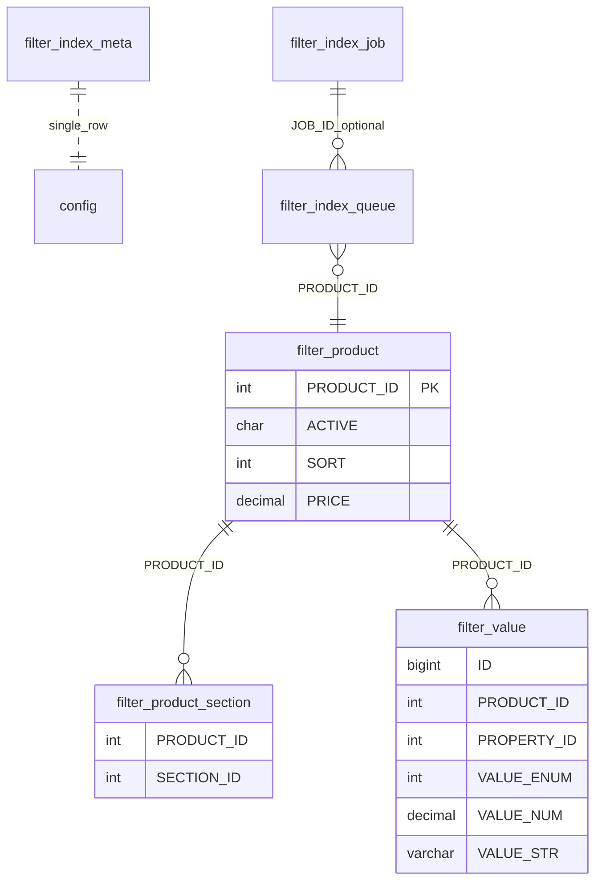
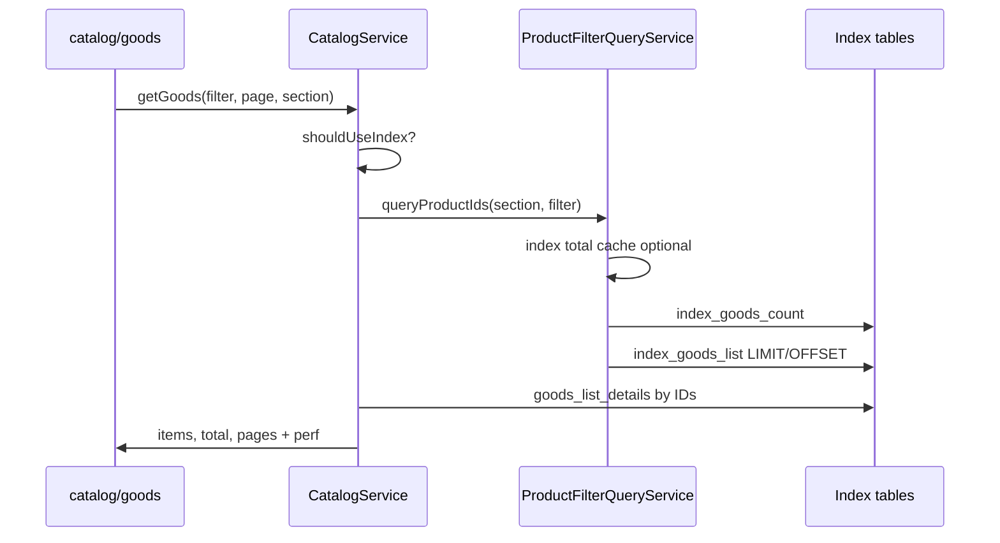

# Логика индекса для фильтра каталога (myapp.catalog)

Документ описывает **product filter index** — денормализованные таблицы для быстрой выборки **списка товаров** (`/catalog/goods`). Это **не** то же самое, что **снапшоты фильтра** (`FilterAggregateService`), которые питают **блок фильтра в UI** (`/catalog/filters`: доступные значения, min/max цены).

---

## 1. Зачем два слоя

| Слой | Назначение | API | Таблицы |
|------|------------|-----|---------|
| **Product filter index** | ID товаров по section + props + цена; count + page | `CatalogService::getGoods()` → index path | `myapp_catalog_filter_*` |
| **Filter snapshots (aggregate)** | Список чекбоксов и диапазон цены для раздела | `CatalogService::getFilters()` | `myapp_catalog_filter_aggregate` + job rebuild |

Индекс **не заменяет** снапшоты: фронт по-прежнему тянет `catalog/filters` для meta; ускоряется в основном **listing** при включённой опции.

---

## 2. Когда индекс используется

В [`ProductFilterIndexService`](../lib/Service/ProductFilterIndexService.php):

- **`use_index_option`** — галочка «Использовать индекс для выборки товаров» (`Assets::OPT_USE_PRODUCT_FILTER_INDEX`).
- **`isIndexReady()`** — option `product_filter_index_ready = Y` **и** `meta.CONFIG_HASH === indexConfigHash()`.

**`indexConfigHash()`** = md5( iblock_id + коды свойств фильтра + код артикула + **код типа цены** + **offers iblock id** + **коды SKU-свойств офферов** ). Смена этих настроек без пересборки → индекс **не готов** (`index_config_stale` в админке).

**`shouldUseIndex()`** = option **и** ready. Тогда в [`CatalogService::getGoods()`](../lib/Service/CatalogService.php) (~301) вызывается **`getGoodsViaProductIndex()`** вместо legacy SQL по `b_iblock_element` + `b_iblock_element_property`.

Ключ кеша `getGoods` включает **`INDEX_VERSION`** при включённом индексе — после full build кеш списков инвалидируется по версии.

---

## 3. Схема данных

Создание: [`ProductFilterIndexSchema`](../lib/Install/ProductFilterIndexSchema.php).

- **`filter_product`** — один ряд на активный товар в индексе (`SORT` для сортировки по умолчанию; **`PRICE`** — MIN цены выбранного типа в валюте storage, см. [`resolveIndexedPrice`](../lib/Service/ProductFilterIndexService.php)).
- **`filter_product_section`** — все привязки товар ↔ раздел (для `section=58` и поддерева через `EXISTS` / `SECTION_ID IN (...)`).
- **`filter_value`** — только свойства из настроек фильтра + артикул; тип хранения по `valueKind`:
  - список (L) → `VALUE_ENUM`;
  - число (N) → `VALUE_NUM`;
  - строка (S) → `VALUE_STR`.
- Дедуп при индексации: один ключ `(property, enum|num|str)` на товар в [`indexProductPropertyValues`](../lib/Service/ProductFilterIndexService.php).

**Индексы БД:** `(PROPERTY_ID, VALUE_ENUM, PRODUCT_ID)`, `(PROPERTY_ID, VALUE_NUM, PRODUCT_ID)` — для join фильтра; **отдельного** `(PROPERTY_ID, VALUE_STR, …)` нет (строковые свойства потенциально медленнее enum).

**Цена на index path:** фильтр `price_from` / `price_to` и сортировка `price_asc` / `price_desc` используют **`p.PRICE`**, без join к **`b_catalog_price`** в [`ProductFilterQueryService`](../lib/Service/ProductFilterQueryService.php). Карточки по-прежнему берут цену для отображения из каталога.

---

## 4. Построение и обновление индекса

### 4.1. Одна единица работы — `rebuildProduct($productId)`

[`ProductFilterIndexService::rebuildProduct`](../lib/Service/ProductFilterIndexService.php):

1. `removeProduct` — DELETE строк товара из value, section, product.
2. Читает элемент из `b_iblock_element`; если нет или `ACTIVE != Y` — **останавливается** (товар исчезает из индекса).
3. INSERT в `filter_product` (в т.ч. **`PRICE`** через `resolveIndexedPrice` — для SKU **MIN** цены активных офферов), все `b_iblock_section_element` → `filter_product_section`, свойства родителя → `filter_value`, затем **`indexMergedOfferPropertyValues`** — значения свойств фильтра/SKU с офферов (по `CML2_LINK`) дописываются в индекс **родителя** с ID свойств офферного инфоблока.

Изменения **оффера** или его цены инвалидируют индекс **родительского** товара ([`CatalogCacheHandler`](../lib/Event/CatalogCacheHandler.php)).

### 4.2. Job-типы ([`ProductFilterIndexJobService`](../lib/Service/ProductFilterIndexJobService.php))

| Тип | Старт | Очистка данных | TOTAL | После успеха |
|-----|--------|----------------|-------|--------------|
| **full** | Админ «Полное построение» | **truncate** 3 таблиц + clear queue | все active товары | `finalizeFullBuild`: version++, LAST_FULL_SYNC, partial=0, markReady |
| **section** | ID раздела, lazy по поддереву | **нет** truncate | товары поддерева | `finalizeSectionJob`: markReady, **partial_section_id** |
| **sync** | Программно / legacy | DELETE лишних `filter_value` по PROPERTY_ID; **нет** truncate | все active | `finalizeSyncJob` (без version/full sync date) |
| **product** | Один ID в очереди | — | 1 | без finalize «ready» |

**Lazy enqueue** (full, sync, section): job не кладёт все ID сразу; `fillQueueFromCursor` порциями (до 800) в `filter_index_queue`, cursor в `PARAMS_JSON`.

**Обработка:** `runStep(batch)` — dequeue → `rebuildProduct` → progress job; агент Bitrix ~90 с, админ AJAX, CLI [`product_filter_index_worker.php`](../tools/product_filter_index_worker.php).

### 4.3. Инкрементальная очередь (без job)

При изменении товара [`CatalogService::invalidateByElement(..., true)`](../lib/Service/CatalogService.php) → **`ProductFilterIndexQueueService::enqueue($elementId)`** (события iblock в [`CatalogCacheHandler`](../lib/Event/CatalogCacheHandler.php)).

Агент **`runStep`** обрабатывает очередь **даже без running job** — точечный reindex. При удалении элемента — **`removeProduct`** напрямую.

Изменение **цены** (`OnPrice*`) — инвалидирует кеш каталога и ставит товар в очередь индекса; **`PRICE`** обновляется при следующем `rebuildProduct`.

### 4.4. Админка и настройки

- Вкладка «Индекс фильтрации»: full, section (тест), clear, прогресс job.
- После смены iblock / свойств фильтра / артикула — **предупреждение** пересобрать индекс (auto-sync на Save **отключён**); рекомендуется **full**.
- Option **`product_filter_index_partial_section_id`**: после section job ≠ 0 — UI предупреждает о «частичном» покрытии; full сбрасывает в 0.

---

## 5. Запрос списка товаров (index path)

[`ProductFilterQueryService::queryProductIds`](../lib/Service/ProductFilterQueryService.php):

1. Поддерево раздела: `CatalogService::getSectionIdsInSubtree($sectionId)`.
2. Нормализация фильтра для count/SQL: `CatalogService::normalizeIndexFilterForCount`.
3. **`buildFilterBaseSql`**: FROM `filter_product p`; свойства — **INNER JOIN** `filter_value`; цена — **`p.PRICE`**; WHERE active + iblock + **EXISTS** по `filter_product_section`.
4. **Total:** кеш в `CACHE_DIR_GOODS_COUNT` (ключ `index|…`, **без page/sort**) или SQL `index_goods_count`.
5. **SELECT DISTINCT … ORDER BY** (`p.SORT`, `p.PRICE`, join `b_iblock_element` для name) — `index_goods_list`.
6. [`getGoodsViaProductIndex`](../lib/Service/CatalogService.php) догружает карточки: **`loadGoodsDetailsByIds`**.

**Perf:** `index_path: true`, `count_mode: product_index`. При пагинации смотреть **`count_cache_hit`**: после первой страницы фильтра count может браться из кеша. Кеш **`getGoods`** (`CACHE_DIR_GOODS`) по-прежнему кеширует **целую страницу** (ключ с `page`).

**Legacy path** (индекс выкл или not ready): те же фильтры через JOIN к `b_iblock_element_property` — медленнее на больших каталогах; count через **`getTotalCountCached`**.

---

## 6. Связь с UI фильтра

- [`CatalogFilter.js`](../js/catalog/components/filter/CatalogFilter.js) шлёт `props[CODE][]`, `price_from/to`, `section` в `goods`.
- Meta фильтра (`properties`, `price.min/max`) — из **`getFilters`** / aggregate, не из product index.
- После «Применить» URL и `loadGoods` — index path при `shouldUseIndex()`.

---

## 7. Ограничения и краевые случаи

- **Section job без full:** в индексе могут остаться товары **вне** поддерева; API с `section` корректен по EXISTS, но «лишние» строки в таблицах остаются до full/clear.
- **Товар убрали из раздела:** section job не пройдёт по ID; строки в index могут устареть до full или события/очереди на этот товар.
- **Неактивный товар:** не попадёт в lazy enqueue full/sync; старые строки sync **может не удалить** — full надёжнее.
- **Строковые свойства фильтра:** работают, но без индекса `(PROPERTY_ID, VALUE_STR)`; **список (L)** предпочтительнее для join.
- **Снапшоты фильтра** при смене настроек помечаются stale отдельно (`markFilterSnapshotsForRebuild` в `options.php`); product index требует **своей** full пересборки.

---

## 8. Ключевые файлы (ориентир)

| Роль | Файл |
|------|------|
| Ready / hash / finalize | [`ProductFilterIndexService.php`](../lib/Service/ProductFilterIndexService.php) |
| Jobs / agent / lazy queue | [`ProductFilterIndexJobService.php`](../lib/Service/ProductFilterIndexJobService.php) |
| SQL выборки | [`ProductFilterQueryService.php`](../lib/Service/ProductFilterQueryService.php) |
| Переключение index vs legacy | [`CatalogService.php`](../lib/Service/CatalogService.php) `getGoods`, `getGoodsViaProductIndex` |
| Очередь | [`ProductFilterIndexQueueService.php`](../lib/Service/ProductFilterIndexQueueService.php) |
| События iblock | [`CatalogCacheHandler.php`](../lib/Event/CatalogCacheHandler.php) |
| UI фильтра (snapshots) | [`FilterAggregateService.php`](../lib/Service/FilterAggregateService.php), [`FilterRebuildJobService.php`](../lib/Service/FilterRebuildJobService.php) |

---

## 9. Узкие места при запросах (total, list, кеш)

### 9.1. Один вызов `/catalog/goods` — что дорого

**Index path** (`getGoodsViaProductIndex` → `ProductFilterQueryService::queryProductIds`):

| Этап | perf label | Типичная доля | Суть |
|------|------------|---------------|------|
| **Total (count)** | `index_goods_count` | **~45–55%** SQL времени | `COUNT(DISTINCT p.PRODUCT_ID)` с теми же JOIN, что и список |
| **Список ID** | `index_goods_list` | **~40–50%** | Почти тот же FROM/JOIN/WHERE + `ORDER BY` + `LIMIT 12` |
| **Карточки** | `goods_list_details` | **<1%** | `SELECT … WHERE e.ID IN (12 id)` — лёгкий |
| **Раздел** | `section_bounds`, `section_ids_by_bounds`, `section_subsections` | **<1%** | Малые справочные запросы до index SQL |

**Legacy path** (индекс выкл): отдельно `goods_count` / `goods_count_cache_hit`, `goods_list`; count может идти через **`getTotalCountCached`** (`CACHE_DIR_GOODS_COUNT`) — **отдельный** кеш только для total, не путать с кешем всего ответа `getGoods`.

**Index path — кеш total:** [`queryProductIds`](../lib/Service/ProductFilterQueryService.php) пишет/читает `{ total }` в **`CACHE_DIR_GOODS_COUNT`** с ключом `buildIndexGoodsTotalCacheKey` (раздел + нормализованный фильтр + `INDEX_VERSION` + `indexConfigHash`, **без page и sort**). Инвалидация — те же теги раздела, что у legacy count; полный сброс каталога чистит `/catalog/goods_count/`.

Кеш **`getGoods`** (`CACHE_DIR_GOODS`) кеширует **готовый ответ** (items + total + pages). Ключ включает **page**. Без `skip_cache=1` повтор **того же URL** — `cache_hit`; листание page 2…N без прогретого goods-кеша выигрывает от **кеша total** (нет повторного `index_goods_count`).

### 9.2. Почему `index_goods_count` — главное узкое место (при cache miss)

1. **`COUNT(DISTINCT p.PRODUCT_ID)`** по цепочке JOIN — дороже, чем `LIMIT 12`.
2. **Дублирование:** count и list — два прохода с одним `buildFilterBaseSql`.
3. **Каждое свойство** — отдельный `INNER JOIN filter_value`.
4. **`EXISTS` по `filter_product_section`** для поддерева раздела.
5. **Фильтр по цене** — условия по **`p.PRICE`** (после денormalization); устаревший `PRICE` до пересборки индекса даёт неверный отбор.
6. **Строковые свойства (S):** нет индекса `(PROPERTY_ID, VALUE_STR, PRODUCT_ID)`.
7. **Сортировка** `name` — join `b_iblock_element` в list; `price_*` — **`p.PRICE`**, без join цен каталога.

### 9.3. Что **не** является узким местом index path (обычно)

- `loadGoodsDetailsByIds` — 12 товаров.
- `stages_ms.list` в `_perf` у index path — в основном PHP после SQL (сборка карточек, цены для display), не второй тяжёлый SQL listing.
- Размер **partial index** (section job без full): влияет на объём таблиц и планы, но для `section=58` решает **число совпадений в ветке + фильтр**, а не «весь каталог в таблице» (если только legacy хвосты).

### 9.4. Legacy vs index — count

| | Legacy | Index path |
|---|--------|------------|
| Total | `getTotalCountCached`, `goods_count` | `index_goods_count` или **кеш** `index_goods_count_cache_hit` |
| Отдельный кеш total | **Да** (`/catalog/goods_count/`) | **Да** (тот же каталог, ключ `index|…`) |
| Два тяжёлых SQL за запрос | count + list (при фильтрах) | **То же**: count + list |

### 9.5. Другие API (не `/goods`)

| API | Узкое место |
|-----|-------------|
| **`/catalog/filters`** | Чтение **snapshot** (`FilterAggregateService::read`); при stale — rebuild job по разделам, не product index. Тяжёлая **первичная** сборка снапшота, не каждый клик при warm cache. |
| **Пагинация** | count кешируется legacy; list каждый раз | **count** из кеша после 1-й страницы фильтра; list каждый раз |
| **Смена фильтра в UI** | Новый URL → новый cache key → снова count + list на index path. |

### 9.6. Практические выводы (без смены кода)

- В perf смотреть **`slowest`** / `index_goods_count` vs `index_goods_list` — ожидаемо count ≥ list.
- **`skip_cache=1`** — stress-test; в UI без него повторные запросы быстрее за счёт **`cache_hit`** на `getGoods`.
- Уменьшать число **активных измерений** фильтра (свойств) и **не слать price_from/to**, если слайдер на полном диапазоне — меньше join’ов.
- **MATERIAL и др. как список (L)**, не строка — чуть лучше join по enum-индексу.
- **~0.5–1.7 s** SQL на сложном фильтре в ветке с десятками тысяч совпадений — следствие count+list+price, не «индекс не работает» (`index_path: true`).

### 9.7. Дальнейшие направления

- Один SQL: count через window/subquery вместе с list.
- EXISTS вместо JOIN по свойствам (меньше `DISTINCT`).
- Индекс `(PROPERTY_ID, VALUE_STR, PRODUCT_ID)` для строковых свойств.

---

## 10. SKU — чеклист QA

После включения торговых предложений (`CatalogSkuService`, опции **offers iblock** / **SKU property codes**):

1. **Карточка:** чипы свойств ТП, цена/артикул/фото активного оффера, `?uid=` в URL, `popstate` сохраняет выбор.
2. **Список:** `hasOffers` → «от PRICE_MIN», кнопка «Выбрать вариант» вместо прямого добавления.
3. **Корзина:** `offerId` в API, ссылка на `/catalog/element/{parentId}?uid={offerId}`.
4. **Фильтр UI:** enum свойств офферов (COLOR/SIZE) и min/max цены с учётом цен ТП; пересборка снапшотов после смены настроек.
5. **Индекс:** `rebuildProduct` для родителя после изменения оффера/цены оффера; `PRICE` = MIN по офферам.
6. **Seeder:** `scripts/fill_test_sku_furniture.php` — раздел «Фурнитура», 100 SKU × 1–5 офферов; затем full/section rebuild index + snapshots.
